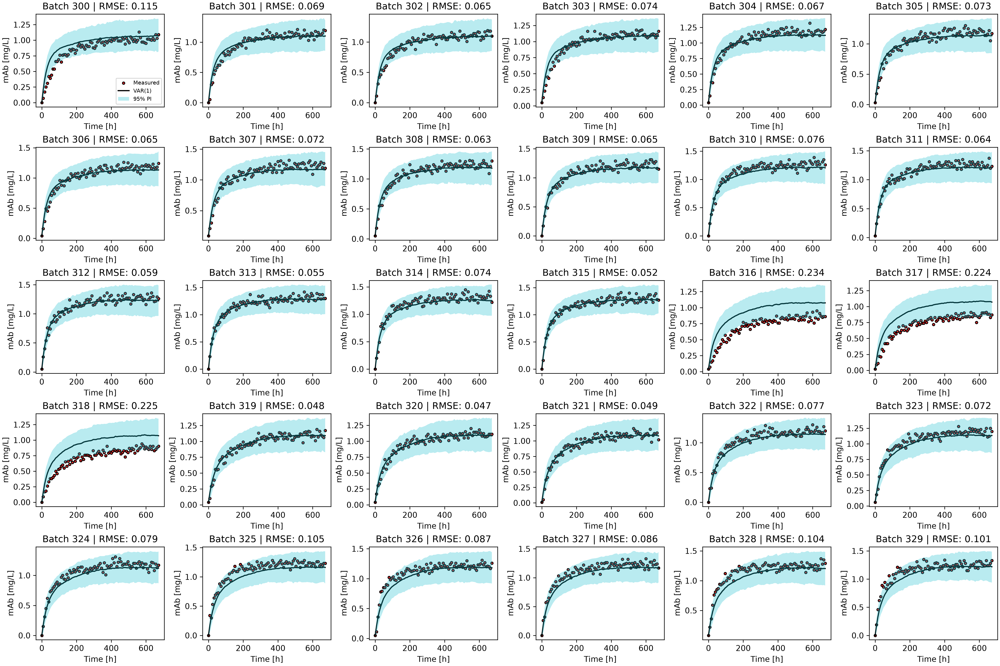
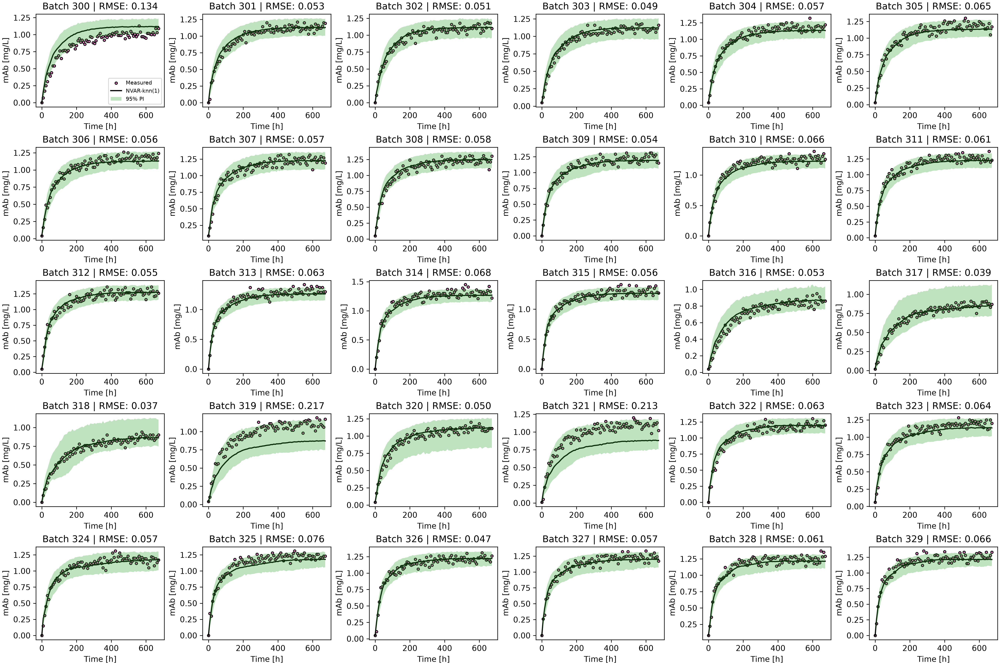
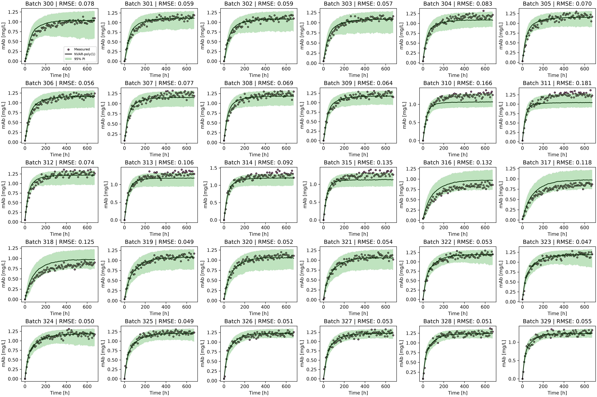
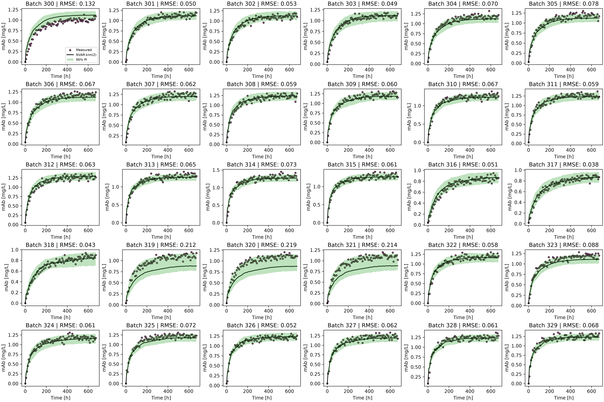
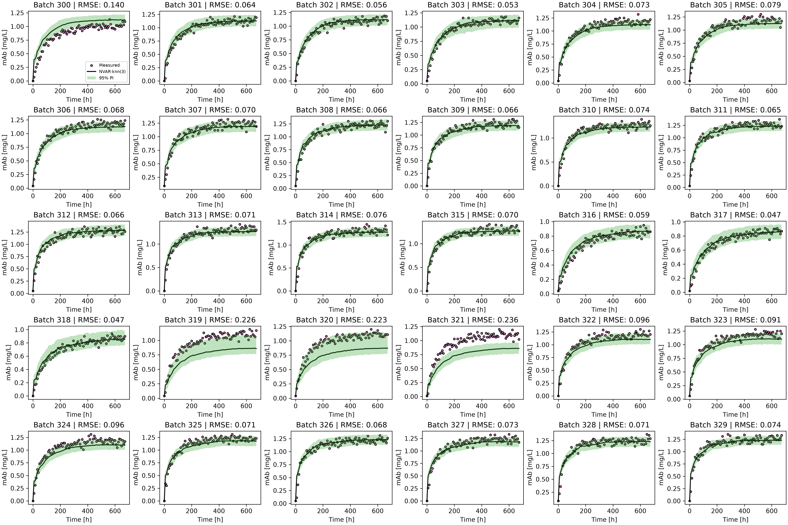

# Monoclonal Antibody Production Optimization Tool
This project develops a predictive bioprocess modeling and economic optimization model for monoclonal antibody (mAb) production in 1L batch bioreactors. Using multivariable experimental time-series data across 30 batch fermentations, this program evaluates linear and nonlinear predictive models to estimate mAb production over time. The pipeline uses Linear Vector Autoregression (VAR) and Non-Linear VAR (NVAR) architectures (Polynomial and K-Nearest Neighbours Regression), by combing cross-validation time series forecasting and white noise residual sampling to determine optimal bioreactor operating conditions. These predictions are used to identify operating conditions that maximize economic returns, specifically space-time profit.

## Highlights
- Develops linear and nonlinear vector autoregressive models to predict monoclonal antibody production over time.
- Evaluates polynomial regression and k-nearest neighbours algorithms using batch-based cross-validation and varying lag orders (p=1,2,3)
- Implements `GridSearchCV` with `GroupKFold` cross-validation to optimize hyperparameters.
- Calculates prediction uncertainty by simulating forward time-series trajectories using residual white-noise sampling, using 1,000 simulations per batch.
- Optimizes bioreactor initial conditions (Glucose, Glutamine, VCD) and harvest timing to maximize space-time profit with 95% prediction intervals.

## Environment
- Python 3.14.7
- matplotlib 3.11.2
- numpy 2.5.3
- pandas 3.0.6
- scikit-learn 1.9.1

## Code Design
### Data Loading and Organization
The program begins by importing the required Python libraries, project classes, functions, and constants. Then, the program parses initial condition parameters (Glucose, Glutamine, VCD) from `initial_conditions.csv` and iteratively loads time-series measurements across 30 batch fermentations (i.e.`batch_0301.csv`). Each batch dataset contains measurements of glucose, glutamine, lactate, ammonia, viable cell density (VCD), total cell density (TCD), and monoclonal antibody concentration over time. The data are organized into individual Batch objects, allowing the measurements from each production run to be accessed and processed consistently. The batch objects are then combined into a single Pandas DataFrame. Each row represents a measurement at a specific time point, with the batch identifier distinguishing between production runs.
### Feature Selection and Lag Matrix Construction
The seven measured process variables (Glucose, Glutamine, Lactate, Ammonia, VCD, TCD, and mAb concentration) are selected as model features and constructs lagged feature matrices through `generate_x_lag_cur_var`. Since the objective is to predict how the bioreactor state changes over time, the program prepares the data using lagged observations. The lag order, represented by p, determines how many previous time points are considered when predicting the next process state. To prevent feature scale disparity during modeling, `StandardScalerVAR` scaling transformations are applied within pipeline structures. This preparation is necessary because the models must account for the relationship between current process conditions and their previous values, and testing multiple lag orders is important for seeing how much historical information is useful for making the predictions. 
### Cross-Validation and Hyperparameter Optimization
Model training and hyperparameter tuning are done by leaving one batch out in cross-validation across all 30 batch runs. Within each training fold, `GridSearchCV` paired with 3-fold `GroupKFold` cross-validation evaluates different hyperparameters (Polynomial expansion degrees 2–3 and kNN neighbor sizes 2–5). This is to ensure the predictive behaviour is accurate on unseen batch fermentations. This also allows their predictive performance to be compared using the mean root mean squared error (RMSE).
### VAR
The first modelling approach is a linear vector autoregressive (VAR) model. This model predicts the next state of the bioreactor using a linear relationship between the previous measurements of all selected process variables.

The program evaluates three lag orders, ranging from one to three previous observations. A linear regression model is trained using the lagged measurements from the training batches. In each iteration, one complete batch is excluded from training and used to assess the model's predictive accuracy. This prevents measurements from the same batch from appearing in both the training and testing datasets.
### NVAR
The second modelling approach extends the VAR framework by evaluating nonlinear relationships between process variables. Two regression algorithms are polynomial regression and k-nearest neighbours (kNN). 

Polynomial regression uses polynomial transformations of the lagged input variables to capture nonlinear relationships. Polynomial degrees of two and three are evaluated.

The k-NN model predicts the process states based on the similarity between the current lagged measurements and observations in the training dataset. kNN sizes ranging from two to five are evaluated using uniform weighting.
### Uncertainty and Forecasting
For each model configuration, multiple simulations are conducted to generate predicted bioreactor trajectories. Residual errors sampled from the training data are incorporated into the predictions to represent uncertainty. This is done from extracting residual error vectors ($X_{\text{cur, train}} - \hat{X}_{\text{cur, train}}$) from training predicitons. To reflect white noise process in the residuals, 1000 simulations are run by randomly sampling residual vectors at each time step, however since the computing time is long, it is possible to change `N_Simulations` in `contants.py` in the src folder to decrease the computing time. Furthermore, state predictions have physical boundaries, such as non-negative concentrations and domain bounds for numerical stability as these values would not be possible.  

The median predicted mAb concentration is compared against the measured concentration for each held-out batch. The RMSE is calculated to quantify the difference between predicted and measured values.

Figures showing the measured and predicted mAb concentrations are exported to the figures/ directory. These figures display measured states against median forecasts and 95% prediction intervals across all 30 batches, using subplots for the mutli-panel trajectories. Model comparison results, including the mean RMSE and its standard deviation, are exported as CSV files to the tables directory.
### Economic Evaluation
The nonlinear model configuration with the lowest mean RMSE is selected for the initial economic evaluation. For each batch, the corresponding median mAb forecast is retrieved and evaluated at different possible harvest times. The initial glucose concentration, glutamine concentration, and VCD are used to calculate the initial cell culture cost. The predicted mAb concentration determines the estimated product value and resulting profit. Space time profit is then calculated by dividing profit by the total production cycle, including a 1 day downtime between batch runs. 

The harvest time associated with the highest predicted space-time profit is identified for each evaluated batch. The resulting economic performance metrics are organized into a DataFrame and exported to Economic_results.csv

## Analysis
### Experimental Data and Initial Conditions
The modelling and optimization process was based on 30 batch experiments selected from the available monoclonal antibody production dataset. Each batch contained time-series measurements describing the changes in glucose, glutamine, lactate, ammonia, viable cell density (VCD), total cell density (TCD), and monoclonal antibody (mAb) concentration throughout the production process.

The 30 batches provided a dataset of 2,550 time-series measurements. Using multiple batches allowed the models to learn how the culture variables changed over time under different initial operating conditions. The initial glucose concentration, initial glutamine concentration, and initial VCD are important because they influence both the predicted production profile and the estimated cost of each batch.

The selected batches represented different combinations of initial conditions, allowing the economic performance of the tested configurations to be compared. The final recommendation was based on the configuration that produced the highest predicted space time profit among the 30 evaluated batches. This approach identifies the best performing configuration within the evaluated experimental dataset. 
### Model Architecture and Selection
Two types of vector autoregressive models were investigated, linear VAR models and nonlinear VAR (NVAR) models. Both approaches used historical measurements to predict the future behaviour of the culture variables. The models were evaluated using lag orders of one, two, and three. A lag order determines how many previous time points are used to predict the current state of the system. For example, a model with one lag uses the measurements from the previous time point, while a model with three lags uses measurements from the three previous time points. 

The linear VAR models used linear regression to estimate relationships between the lagged variables and their current values. This approach creates a relatively simple model, but it assumes that the relationships between the process variables can be represented linearly.

To investigate whether nonlinear relationships could improve predictions, two NVAR approaches were also evaluated, polynomial regression and k-nearest neighbours (kNN). Polynomial regression extends a linear model by including higher-order terms, allowing it to represent more complex relationships. The kNN approach predicts values based on similar observations (neighbours) in the training dataset. This allows it to capture nonlinear patterns without requiring a predefined mathematical equation or relationship between the variables.

Model performance was evaluated using batch-based cross-validation. The linear VAR models used leave-one-batch-out validation, while the nonlinear models used three-fold GroupKFold validation, keeping measurements from the same batch together. This was needed because measurements from an individual batch are related to one another. Keeping batches grouped helps prevent values from the same experiment from appearing in both training and validation data.

The nonlinear models were evaluated using polynomial degrees of two and three, and kNN neighbourhood sizes ranging from two to five. The configuration with the lowest mean root mean squared error (RMSE) was selected as the preferred predictive model.
### Model Comparison and Performance
The results showed that the nonlinear models generally provided better predictive performance than the linear VAR models. Among the tested configurations, the kNN model with a lag order of one achieved the lowest mean RMSE of 0.07004, making it the best performing model in the comparison. This is shown in the NVAR_results and VAR_results tables below and the tables/ directory.
##### Linear VAR Model Comparison
| Lag Order (p) | Simulations | Mean RMSE | RMSE SD |
|---:|---:|---:|---:|
| 1 | 1000 | 0.088173 | 0.049269 |
| 2 | 1000 | 0.081676 | 0.044506 |
| 3 | 1000 | 0.081053 | 0.042588 |
##### Nonlinear VAR Model Comparison
| Model Type | Lag Order (p) | Simulations | Mean RMSE | RMSE SD |
|---|---:|---:|---:|---:|
| Polynomial | 1 | 1000 | 0.078861 | 0.036264 |
| Polynomial | 2 | 1000 | 0.085836 | 0.054161 |
| Polynomial | 3 | 1000 | 0.078387 | 0.041501 |
| **kNN**  | **1**  | **1000**  | **0.070040** | **0.041884**  |
| kNN | 2 | 1000 | 0.078839 | 0.048144 |
| kNN | 3 | 1000 | 0.087823 | 0.049812 |

The linear VAR models achieved mean RMSE values of 0.08817, 0.08168, and 0.08105 for lag orders one, two, and three, respectively. Increasing the lag order improved the performance of the linear models slightly, although the improvement became smaller between 2 and 3 lags. The polynomial model's lowest mean RMSE was 0.07839, which was obtained using a polynomial degree of 3 and a lag order of 3. However, increasing the lag order did not consistently improve polynomial model performance. The kNN models showed the strongest overall results. The one-lag configuration achieved a mean RMSE of 0.07004, compared with 0.07884 for two lags and 0.08782 for three lags. This suggests that using the most recent time point provided sufficient information for predicting the next state of the system, while including additional historical measurements did not improve performance.

Based on these comparisons, the kNN NVAR model with one lag was selected for the economic evaluation. Its lower mean RMSE suggests that it was better able to reproduce the observed process behaviour than the other tested configurations.

Multi-batch trajectory visualizations for all the architectures are saved in the figures/ directory for all lag orders. The figures shown below are for p=1, VAR, NVAR kNN, and NVAR Polynomial.
##### Linear VAR Model Predictions p=1

##### Nonlinear VAR Model Predictions kNN p=1

##### Nonlinear VAR Model Predictions Polynomial p=1

The results are analyzed visually from the multi-batch figures, such as NVAR_knn_p1.png versus higher-lag configurations. At lag order p=1, the kNN model tracks the sharp initial growth phase and the plateau of mAb accumulation smoothly across all 30 subplot panels with tight prediction intervals. In contrast, increasing the lag order to p=3 introduces higher variance across the batch grid, as shown by the wider prediction interval bands and slight fluctuations in predictions during early fermentation phases. The p=2 and p=3 kNN figures are shown below.
##### Nonlinear VAR Model Predictions kNN p=2

##### Nonlinear VAR Model Predictions kNN p=3

### Economic Evaluation and Recommended Operating Conditions
The selected kNN NVAR model was used to predict mAb production over time for each of the 30 evaluated batch configurations. These predictions were combined with the economic functions to calculate culture cost, product value, profit, and space time profit at different potential harvest times. Space time profit was used as the primary optimization metric because it accounts for both the economic return from the product and the time required to complete production.

This metric is useful because a batch that produces a higher final mAb concentration doesn't necessarily provide the best overall production performance. A longer production period may reduce the number of batches that can be completed over a given period. Therefore, the harvest time that maximizes space time profit may occur before the maximum mAb concentration is even reached.

The economic results identified Batch 322 as the best performing configuration among the 30 evaluated batches. Its initial operating conditions were 15.11 mM glucose, 1.98 mM glutamine, and an initial VCD of 654,264.21 cells/mL. The predicted mAb concentration at the selected harvest time of 64 hours was 0.851 mg/L. At this point, the estimated profit was 361 $/L, corresponding to a space-time profit of approximately 98.45 $/(L·d). This was the highest space-time profit obtained among the evaluated configurations.
The recommended operating conditions are summarized below:
Recommended Initial Glucose Concentration: 15.11 mM
- Recommended Initial Glutamine Concentration: 1.98 mM
- Recommended Initial Viable Cell Density (VCD): 654,264.21 cells/mL
- Recommended Harvest Time: 64 hours (2.67 days)
- Predicted mAb Concentration: 0.851 mg/L
- Estimated Profit: 361 $/L
- Estimated Space-Time Profit: 98.45 $/(L·d)
- Estimated Space-Time Yield: 0.319 mg/(L·d)

The configuration with the highest mAb concentration is not necessarily the most economically favourable, since the initial nutrient and cell concentrations contribute to the cost of each batch. The full economic results for the 30 batches are in the tables/ directory, as well as batch 322 shown below.
##### Economic Results
| Batch ID | Harvest Time (h) | Predicted mAb (mg/L) | Profit ($/L) | Space-Time Profit ($/(L·d)) |
|---:|---:|---:|---:|---:|
| 322 | 64 | 0.851 | 361 | **98.45** |
### Limitations and Considerations
The recommended operating conditions represent the best performing configuration among the 30 batches evaluated in this analysis. Because only a subset of the available experimental dataset was used, other combinations of initial conditions may produce different results. The recommendation should therefore be interpreted as the best configuration identified within the evaluated dataset rather than a guaranteed overall optimum.

Furthermore, the predictive models rely on the assumption that the relationships learned from the available 30 batches will remain representative for future production forecasts. Thus, differences between experimental batches and uncertainty in the model predictions may affect the accuracy of the estimated mAb concentrations and economic outcomes.

Despite these limitations, the analysis provides a systematic method for comparing predictive models and evaluating the economic performance of different batch configurations. Selecting the kNN NVAR model based on its validation performance and using space time profit to compare operating conditions provides a basis for recommending an initial culture configuration and harvest time.